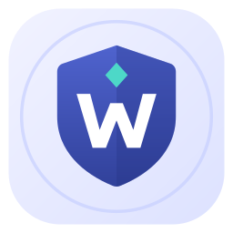

<picture>
  <source media="(prefers-color-scheme: dark)" srcset="docs/assets/warden-logo-dark.svg" />
  <source media="(prefers-color-scheme: light)" srcset="docs/assets/warden-logo-light.svg" />
  
</picture>

# Warden

**Take your attention back. A strict, private focus guardian for Android.**

Warden watches for distracting keywords across your phone and sends you straight back to the home screen before a quick check turns into an hour of doomscrolling. Need a temporary pass? You'll have to convince an adversarial **Gemini AI Gatekeeper** whose default answer is **NO**.

[-4355B5.svg)](https://github.com/mehad605/Warden/releases/latest)

[**Download Latest APK**](https://github.com/mehad605/Warden/releases/latest) · [How It Works](#how-warden-protects-your-focus) · [Quick Setup](#installation--setup) · [Privacy](#privacy-first) · [Emergency Uninstall](#emergency-uninstall) · [**For Developers →**](DEVELOPERS.md)

---

## Why Warden?

Most blockers are too easy to switch off the second an impulse hits. Warden is built to actually hold the line:

- **Instant Keyword Shield** — Flag words or topics that pull you off track (like `shorts`, `reels`, or `trending`). Whenever they appear on screen in any app, Warden steps in and returns you home.
- **Smart Whitelist Exceptions** — Add safe phrases (like `"basketball shorts"`) so you never get interrupted while doing real work.
- **Grace Period Re-Check** — Set a 0–5 second grace window (2 seconds by default) so brief, accidental mentions don't kick you out—only lingering distractions do.
- **Adversarial AI Gatekeeper** — Want a temporary app exemption or a short pause? Write a genuine justification (and optionally attach a screenshot as proof) to Gemini. Low-effort excuses get rejected, and repeated rejections make future approvals even harder.
- **Anti-Uninstall & Self-Protection** — Optional Device Administrator lock paired with system-settings guards stops impulsive Force Stops, Clear Data taps, Accessibility revocations, and quick uninstalls.
- **Password-Locked Rules** — Lock keyword removal, grace-period edits, and Anti-Uninstall behind a strong local password.
- **Safe Backup & Restore** — Export your setup to JSON (with an opt-in choice for sensitive credentials) and merge backups back in without weakening your active rules.
- **Ultra-Light Footprint** — ~1.5 MB APK, zero background polling, zero native bloat, built to stay fast and quiet even on 4 GB RAM phones.

---

## Installation & Setup

1. Download **`Warden-vX.Y.Z.apk`** from [**GitHub Releases**](https://github.com/mehad605/Warden/releases/latest).
   - *(Optional)* Download `SHA256SUMS.txt` and verify integrity: `sha256sum -c SHA256SUMS.txt`.
2. Install the APK on any Android **8.0 (API 26)** or newer device.
3. Open **Warden**, accept the terms, and enable **Warden** in **Settings → Accessibility**.
4. Add your blocked keywords, optional whitelist phrases, and set a configuration password.
5. *(Optional)* Add a free [Google AI Studio](https://aistudio.google.com/app/apikey) Gemini API key to enable the AI Gatekeeper, and turn on **Anti-Uninstall Protection** once you're happy with your rules.

> **Heads Up:** Once Anti-Uninstall Protection is turned on, Warden intentionally makes it hard to disable or uninstall itself in the heat of the moment. Read [Emergency Uninstall](#emergency-uninstall) before enabling it.

---

## Privacy First

- **100% offline keyword scanning:** Everything on your screen stays on your phone—never recorded, never uploaded.
- **Zero analytics, ads, or trackers:** Warden has no backend server and collects zero telemetry.
- **Direct-to-Gemini AI only when you ask:** The app only touches the internet when you explicitly configure your own Gemini API key and submit a Gatekeeper request (or refresh the model list), communicating directly with `generativelanguage.googleapis.com` over HTTPS.

---

## Guides

- [How the Blocker Works](docs/how-it-works.md) — Keyword matching, whitelist masking, grace period, and self-protection
- [AI Gatekeeper Guide](docs/ai-gatekeeper.md) — Validation rules, proof requirements, and credibility score (`noCount`)
- [Anti-Uninstall Protection](docs/anti-uninstall.md) — Device Admin lock and 3-minute activation grace window
- [Configuration Reference](docs/configuration.md) — Every setting, default, and merge-safe backup format

---

## Emergency Uninstall

Warden intentionally does **not** include copy-paste bypass commands here—making removal require deliberate effort is part of the point.

If you are genuinely locked out (forgot your password and need to uninstall Warden), you still have full ownership of your device:

1. **Via Safe Mode:** Reboot into Android Safe Mode (which temporarily suspends third-party Accessibility Services), deactivate Warden under **Settings → Security → Device admin apps**, and uninstall normally.
2. **Via a Computer (ADB):** Connect your phone over USB Debugging and ask an AI assistant or look up the general recovery flow:
   > *"How do I use ADB on Android to temporarily clear enabled Accessibility Services, deactivate a Device Administrator app in Settings, and uninstall a package by its application ID?"*

Once you follow that flow, you can cleanly deactivate Device Admin and remove Warden.

---

## For Developers

Interested in the architecture, building from source, running the test/lint suite, or contributing?

See **[DEVELOPERS.md](DEVELOPERS.md)** for the full technical overview, local build commands, architecture boundaries, and release workflow, and **[CONTRIBUTING.md](CONTRIBUTING.md)** for contribution guidelines.

---

## License

MIT License — see [LICENSE](LICENSE).
