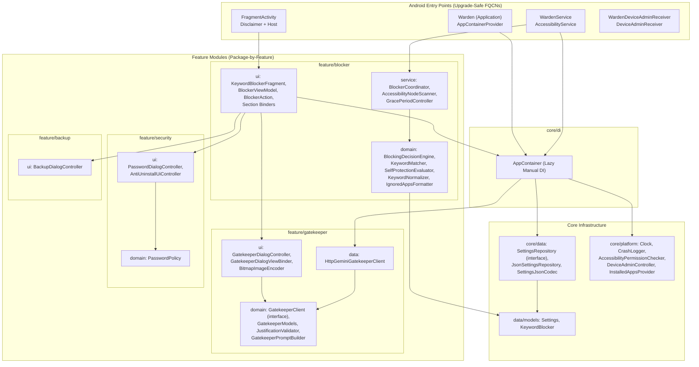
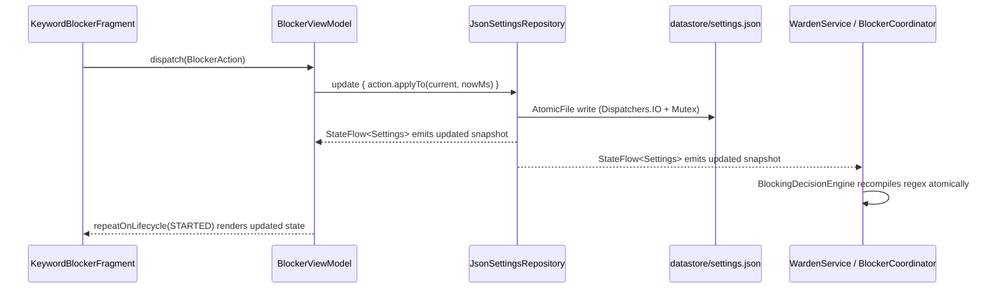
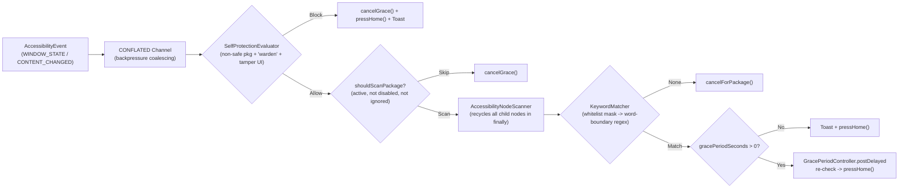

# Warden Architecture

This document explains Warden's layered package-by-feature architecture, data flows, dependency boundaries, and runtime footprint design.

---

## 1. High-Level Architecture

---

## 2. Module & Package Map

Warden is a single Gradle module (`:app`) organized into strict, architecture-tested packages (`ArchitectureRulesTest` enforces layering and zero circular package dependencies):

| Package | Layer | Responsibility |
|---|---|---|
| `com.warden.app` | Entry | `Warden` (`Application` + `AppContainerProvider` + debug `StrictMode`) |
| `com.warden.app.data.models` | Model | Pure immutable `Settings` and `KeywordBlocker` data classes |
| `com.warden.app.core.data` | Data | `SettingsRepository` interface, atomic single-process `JsonSettingsRepository`, reflection-free `SettingsJsonCodec` |
| `com.warden.app.core.platform` | Platform | `Clock`, bounded/rotated `CrashLogger`, `AccessibilityPermissionChecker`, `DeviceAdminController`, bounded-cache `InstalledAppsProvider` |
| `com.warden.app.core.di` | Composition | `AppContainer` & `AppContainerProvider` (lazy manual DI, zero reflection) |
| `com.warden.app.feature.blocker.domain` | Domain (Pure) | `KeywordMatcher`, `SelfProtectionEvaluator`, `BlockingDecisionEngine`, `KeywordNormalizer`, `IgnoredAppsFormatter` |
| `com.warden.app.feature.blocker.service` | Service Adapter | `BlockerCoordinator`, `AccessibilityNodeScanner` (guaranteed node recycling), `GracePeriodController` |
| `com.warden.app.feature.blocker.ui` | UI | `KeywordBlockerFragment`, `BlockerViewModel`, self-reducing `BlockerAction`, `DashboardControllers`, and section binders |
| `com.warden.app.feature.gatekeeper.domain` | Domain (Pure) | `GatekeeperClient` interface, `GatekeeperRequest`/`GatekeeperVerdict`, `JustificationValidator`, `GatekeeperPromptBuilder` |
| `com.warden.app.feature.gatekeeper.data` | Data | `HttpGeminiGatekeeperClient` over platform `HttpURLConnection` + `org.json` |
| `com.warden.app.feature.gatekeeper.ui` | UI | `GatekeeperDialogController`, `GatekeeperDialogViewBinder`, bounded JPEG `BitmapImageEncoder` |
| `com.warden.app.feature.security.domain` | Domain (Pure) | `PasswordPolicy` (strength validation & constant-time SHA-256 verification) |
| `com.warden.app.feature.security.ui` | UI | `PasswordDialogController`, `AntiUninstallUiController` |
| `com.warden.app.feature.backup.ui` | UI | `BackupDialogController` (off-main-thread `ContentResolver` JSON read/write) |
| `com.warden.app.services` | Android Entry | `WardenService` (`AccessibilityService` — FQCN preserved for upgrade safety) |
| `com.warden.app.receivers` | Android Entry | `WardenDeviceAdminReceiver` (`DeviceAdminReceiver` — FQCN preserved for upgrade safety) |
| `com.warden.app.ui.activity` | Android Entry | `FragmentActivity` (launcher activity — FQCN preserved for upgrade safety) |

---

## 3. Core Data Flows

### Settings Mutation → UI & Background Service Sync

Because both the UI and `WardenService` share the process-scoped `SettingsRepository` inside `AppContainer`, settings propagate instantaneously via `StateFlow` without any `BroadcastReceiver` or extra IPC.

### Accessibility Event → Self-Protection & Keyword Scan

---

## 4. Runtime Footprint & Idle-State Design

Designed specifically for constrained Android 11 devices (4 GB RAM, Helio G85, aggressive OEM background killing):

- **Minimal `Application.onCreate()`:** Installs lazy `CrashLogger` (resolves `filesDir` only on error) and debug-only `StrictMode`. Zero synchronous disk or network I/O at startup.
- **Trimmed startup initializers:** `AndroidManifest.xml` removes `EmojiCompatInitializer` and `ProcessLifecycleInitializer` from `androidx.startup.InitializationProvider`. Only `ProfileInstallerInitializer` remains, justified by `app/src/main/baseline-prof.txt` (pre-compiles startup & accessibility hot paths via ART).
- **Idle background state:** Zero WorkManager periodic jobs, zero alarms, zero WakeLocks, zero foreground services. Only Android's system-bound `WardenService` (`AccessibilityService`) runs, and it is strictly **event-driven**: it wakes only when the OS dispatches `TYPE_WINDOW_STATE_CHANGED` or `TYPE_WINDOW_CONTENT_CHANGED`, coalesces bursts via `Channel.CONFLATED`, recycles every `AccessibilityNodeInfo` / `AccessibilityEvent` on API < 33, and consumes zero CPU while the screen is idle.
- **Zero idle UI polling:** `IgnoredAppsListBinder` runs its 1-second countdown coroutine **only** while the fragment is resumed AND at least one temporary app exemption is active; it stops automatically once all exemptions expire or the app backgrounds.
- **Bounded memory & storage:** App icon cache is capped via `LruCache(64)`; screenshot uploads are downscaled to ≤1024px JPEG; `CrashLogger` rotates `crash_log.txt` at 128 KiB (max 256 KiB total on disk).
- **Zero native libraries & minimal DEX:** Eliminating `MultiProcessDataStoreFactory`, `generativeai`, `gson`, and 9 unused dependencies reduced the release APK from **7.51 MB** to **~1.59 MB** with **0 `.so` files** and **12.6k DEX references**.

---

## 5. Architecture Decision Records

Every major architectural tradeoff is documented in [`docs/adr/`](adr/):
- [ADR-0001: Incremental Strangler Overhaul](adr/0001-incremental-strangler-overhaul.md)
- [ADR-0002: Atomic `org.json` SettingsRepository](adr/0002-atomic-org-json-settings-repository.md)
- [ADR-0003: Platform `HttpURLConnection` Gemini Client](adr/0003-platform-http-gemini-gatekeeper.md)
- [ADR-0004: Lightweight Lazy Manual DI Container](adr/0004-manual-lazy-di-container.md)
- [ADR-0005: R8 Full Mode, Resource Shrinking & Baseline Profile](adr/0005-r8-full-mode-and-baseline-profile.md)
